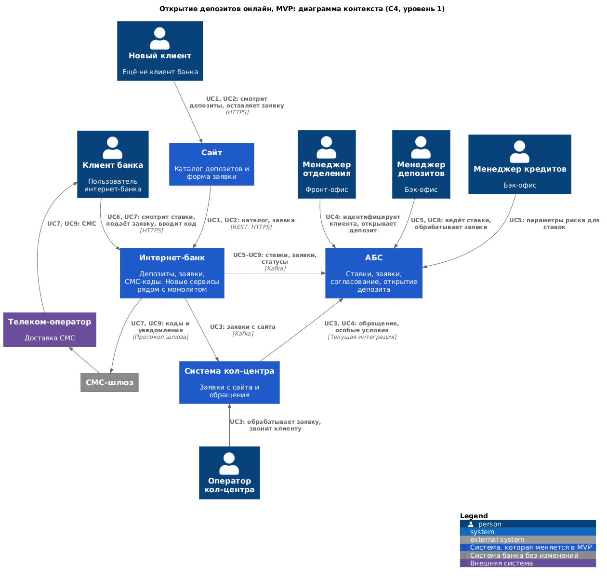
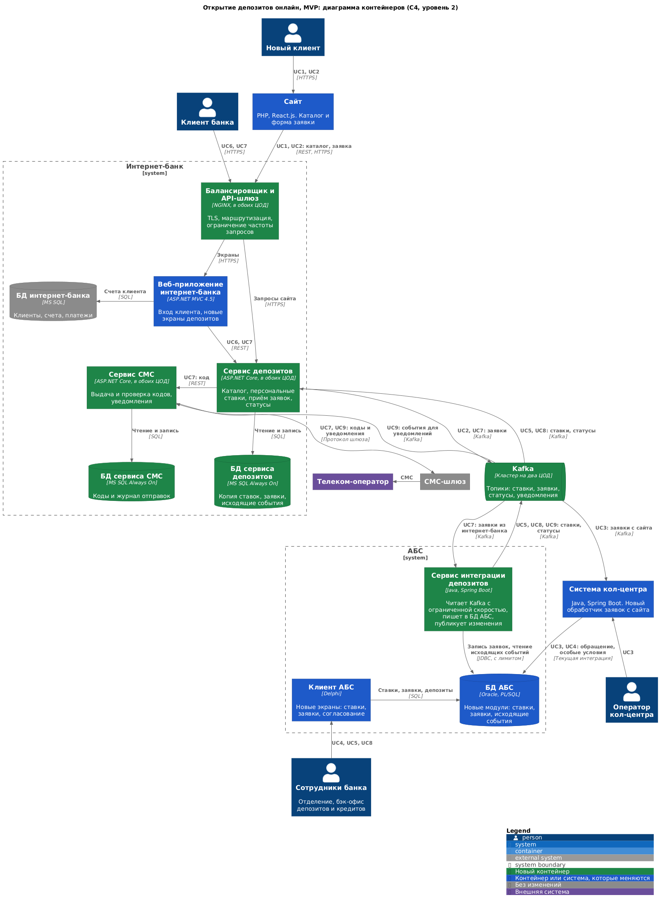

**Функциональные требования**

Коды F, R, P, S и +R ссылаются на [таблицу FURPS+](../Task2/FURPS+.md). Описан основной поток каждого Use Case.

|**№**|**Действующие лица или системы**|**Use Case**|**Описание**|
| :-: | :- | :- | :- |
|UC1|Новый клиент, сайт, интернет-банк (сервис депозитов)|Посмотреть депозиты на сайте|1. Клиент открывает раздел депозитов. 2. Сайт запрашивает каталог в сервисе депозитов. 3. Сервис отдаёт ставки из своей копии, не обращаясь к АБС. (F1)|
|UC2|Новый клиент, сайт, сервис депозитов, Kafka|Оставить заявку на сайте|1. Клиент указывает телефон и Ф. И. О. и даёт согласие на обработку данных. 2. Сайт передаёт заявку в сервис депозитов. 3. Сервис сохраняет её и публикует событие. 4. Клиент видит подтверждение. (F2, +R9)|
|UC3|Система кол-центра, оператор, новый клиент, АБС|Обработать заявку с сайта|1. Система кол-центра получает заявку из Kafka и показывает оператору. 2. Оператор звонит клиенту и при необходимости предлагает особые условия. 3. Оператор заводит обращение, оно передаётся в АБС по текущей интеграции. (F3)|
|UC4|Новый клиент, менеджер отделения, АБС|Открыть депозит в отделении|1. Клиент приходит в отделение. 2. Менеджер проверяет документы и находит обращение в АБС. 3. Создаёт депозит и загружает подписанные документы. (F4)|
|UC5|Менеджер кредитов, менеджер депозитов, АБС, сервис интеграции, сервис депозитов|Вести и публиковать ставки|1. Менеджер кредитов вводит параметры риска. 2. Менеджер депозитов утверждает ставки в АБС. 3. Сервис интеграции публикует изменения в Kafka. 4. Сервис депозитов обновляет копию. (F8)|
|UC6|Клиент, интернет-банк, сервис депозитов|Посмотреть депозиты и персональные ставки|1. Клиент входит в интернет-банк. 2. Веб-приложение запрашивает у сервиса депозитов каталог и персональные ставки. 3. Клиент видит оба варианта с датой действия. (F5)|
|UC7|Клиент, веб-приложение, сервис депозитов, сервис СМС, СМС-шлюз|Подать заявку в интернет-банке|1. Клиент указывает счёт и сумму. 2. Сервис депозитов запрашивает код у сервиса СМС, клиент получает СМС. 3. Клиент вводит код, сервис СМС его проверяет. 4. Сервис депозитов сохраняет заявку и публикует событие. 5. Клиент видит статус «Принята». (F6, F7, F12)|
|UC8|Сервис интеграции, АБС, менеджер депозитов|Обработать заявку в бэк-офисе|1. Сервис интеграции читает заявку из Kafka и записывает в АБС с ограниченной скоростью. 2. Менеджер согласует ставку в АБС и подтверждает условия. 3. Менеджер открывает депозит. 4. АБС фиксирует смену статуса для публикации. (F9, F10)|
|UC9|АБС, сервис интеграции, Kafka, сервис депозитов, сервис СМС, клиент|Сообщить клиенту о результате|1. Сервис интеграции публикует статус «Ставка подтверждена» или «Депозит открыт». 2. Сервис депозитов обновляет статус заявки. 3. Сервис СМС отправляет СМС через шлюз. (F11, F12)|

**Нефункциональные требования**

Значения времени отклика и лимиты указаны как допущения для согласования с бизнесом.

|**№**|**Требование**|
| :-: | :- |
|R1|Сервисы процесса работают 24/7 с доступностью 99,9%.|
|R2|При сбое ЦОД сервисы интернет-банка остаются доступными и выдерживают нагрузку.|
|R3|Отказ или перегрузка АБС не мешают клиенту подать заявку.|
|R4|Заявки и статусы не теряются и не обрабатываются дважды.|
|R5|Ставка, показанная клиенту, актуальна: у неё есть дата действия.|
|P1|Отклик p95: не более 300 мс для чтения и не более 500 мс для записи заявки.|
|P3|Онлайн-заявки не увеличивают нагрузку на БД АБС сверх согласованного лимита.|
|P4|Новые сервисы масштабируются горизонтально, запросы распределяются между серверами и ЦОД.|
|S1, S3|Есть документация API и событий. Решение расширяется до автоматического открытия депозита.|
|S2|Изменения в процессе депозитов не требуют обновления ядра интернет-банка.|
|+R1, +R2|Используются технологии и экспертиза банка: MS SQL, Oracle, .NET, Java.|
|+R3|Очереди строятся на Kafka. Текущая платформа интернет-банка с ней несовместима.|
|+R4|Микросервисы появляются только в рамках задачи депозитов, монолит не переписывается.|
|+R5|В новом процессе интернет-банк не работает напрямую с API и БД АБС.|
|+R6|АБС масштабируется только вертикально.|
|+R7|Данные шифруются при передаче.|
|+R8|Сотрудники депозитов и кредитов не имеют доступа к данным друг друга.|
|+R9|Персональные данные обрабатываются по 152-ФЗ, форма на сайте защищена от автоматических заявок.|
|+R14|Система кол-центра — платформа подрядчика. Её дорабатывает подрядчик или специалисты АБС с опытом Java.|

**Решение**

**Диаграмма контекста.** Файлы: [PNG](c4-context-deposit-mvp.png), [исходник PlantUML](c4-context-deposit-mvp.puml).

**Диаграмма контейнеров.** Детализированы интернет-банк и АБС. Файлы: [PNG](c4-container-deposit-mvp.png), [исходник PlantUML](c4-container-deposit-mvp.puml).

**Какие команды участвуют**

|Команда|Что делает|
| :- | :- |
|Интернет-банк (10 + 10 у подрядчика)|Сервис депозитов, сервис СМС, экраны в веб-приложении|
|АБС (20)|Модули ставок и заявок, экраны в клиенте, сервис интеграции депозитов|
|Специалисты АБС с Java или подрядчик кол-центра (5)|Обработчик заявок с сайта в системе кол-центра|
|Разработчики сайта (команда в описании не указана)|Каталог и форма заявки|
|Инфраструктура IT (команда в описании не указана)|Kafka, балансировщик, MS SQL в двух ЦОД|

**Основные решения и логика выбора**

1. **Ставки ведутся в АБС, а не в отдельной системе (F8, +R1).** Ставки нужны для согласования заявки и открытия депозита, поэтому они ближе всего к данным депозитов. Добавляются таблицы и процедуры PL/SQL и экраны в клиенте Delphi. Менеджер кредитов вводит только параметры риска, а клиентские данные разделов не пересекаются: роли в АБС выполняют +R8.
2. **Онлайн-каналы читают копию ставок (P1, P3, +R5).** Сервис депозитов хранит копию в своей БД и обновляет её по событиям из Kafka. Чтение не доходит до АБС, поэтому её отказ не мешает показывать каталог. У копии есть дата действия, и если обновление задержалось, сервис помечает ставку как требующую уточнения (R5).
3. **Персональные ставки считает АБС пакетно (F5, P3).** Расчёт идёт вне рабочих часов и только для клиентов интернет-банка. Результат публикуется как обычное событие. Клиентские кредитные данные наружу не передаются, только итоговая ставка (+R8).
4. **Заявки идут асинхронно через Kafka (R3, R4, +R3).** Сервис депозитов пишет заявку и событие в одну транзакцию своей БД, а отдельный процесс публикует его (Transactional Outbox). Поэтому заявка не потеряется, если Kafka или АБС недоступны. Идентификатор заявки сквозной, и АБС отвергает повторную запись.
5. **Новый сервис интеграции защищает АБС (P3, +R6).** Только он пишет в БД АБС от имени онлайн-каналов и делает это с настраиваемым лимитом скорости. Излишек ждёт в Kafka, поэтому всплеск заявок увеличивает очередь, а не нагрузку на базу. Сервис написан на Java, потому что в команде АБС есть такая экспертиза. Исходящие события он читает из таблицы в БД АБС редким опросом.
6. **Новые сервисы интернет-банка написаны на ASP.NET Core (+R2, +R3, +R4, S2).** Команда уже знает .NET и может развивать их без ядра подрядчика, а текущая версия монолита с Kafka не работает. Монолит остаётся для входа клиента и показа экранов и вызывает сервис депозитов по REST. Выделяем только то, что нужно депозитам.
7. **Отдельный сервис СМС (F7, S2).** Он выдаёт и проверяет коды без доработки ядра интернет-банка и отправляет уведомления о заявках по событиям. Старые рассылки АБС продолжают работать как раньше, чтобы не менять их в MVP.
8. **Сайт вызывает сервис депозитов через шлюз (F1, F2, +R7, +R9).** Сайт не получает прямого доступа к внутренним системам. На шлюзе работают TLS и ограничение частоты запросов, а на форме защита от автоматических заявок.
9. **Заявка с сайта идёт в кол-центр событием (F3, +R14).** Система кол-центра построена на Java Spring Boot и расширяема, поэтому в неё добавляется обработчик. Дальше работает текущий поток: обращение передаётся в АБС.
10. **Доступность строится для новых сервисов (R1, R2, P4).** Балансировщик, сервисы депозитов и СМС работают в обоих ЦОД одновременно и не хранят состояние в памяти. БД защищена через MS SQL Always On, Kafka реплицируется между ЦОД. Монолит интернет-банка пока остаётся в одном ЦОД с ручным переключением. Это осознанный компромисс, описанный в рисках.

**Как диаграмма покрывает Use Cases**

|Use Case|Путь на диаграмме контейнеров|
| :- | :- |
|UC1, UC2|Сайт → шлюз → сервис депозитов → БД сервиса и Kafka|
|UC3, UC4|Kafka → система кол-центра → БД АБС, затем менеджер отделения → клиент АБС → БД АБС|
|UC5|Клиент АБС → БД АБС → сервис интеграции → Kafka → сервис депозитов|
|UC6|Клиент → шлюз → веб-приложение → сервис депозитов|
|UC7|Веб-приложение → сервис депозитов → сервис СМС → СМС-шлюз, затем сервис депозитов → Kafka|
|UC8|Kafka → сервис интеграции → БД АБС, затем менеджер депозитов → клиент АБС|
|UC9|БД АБС → сервис интеграции → Kafka → сервис депозитов и сервис СМС → СМС-шлюз → телеком-оператор|

**Альтернативы**

1. **Интернет-банк вызывает API АБС напрямую.** Это проще и быстрее для MVP, но нарушает +R5, нагружает перегруженную базу и связывает доступность онлайн-канала с АБС. Отклонено.
2. **Отдельная система ставок вне АБС.** Она не нагружает АБС и проще разграничивает доступ. Но согласование ставки по заявке всё равно идёт в АБС, поэтому появятся две системы и синхронизация между ними. Для MVP отклонено, можно вернуться при автоматическом открытии депозита.
3. **Депозиты внутри монолита интернет-банка.** Команде не нужно осваивать новый контур, но монолит несовместим с Kafka, для СМС нужны работы подрядчика, а масштабировать и резервировать придётся всё целиком. Отклонено.
4. **Обмен файлами или через общую БД вместо Kafka.** Технологии в банке есть, однако задержка выше, повторная обработка сложнее, а новая интеграция по БД повторяет текущую проблему. Требование также указывает на Kafka. Отклонено.
5. **Чтение изменений из журнала Oracle (Debezium) вместо опроса таблицы.** Нагрузка на базу ниже, но нужна новая технология и экспертиза, которой в банке нет. Можно рассмотреть, если опрос окажется заметным для АБС.
6. **Отправлять все СМС из АБС.** Изменений меньше, но код должен приходить сразу, а АБС при этом может быть перегружена. Отклонено для кодов и новых уведомлений.

**Недостатки, ограничения, риски**

1. **Монолит интернет-банка не закрывает R2.** При сбое основного ЦОД вход и экраны недоступны до ручного переключения, поэтому 99,9% для всего интернет-банка не гарантируется. Команда интернет-банка уже считает требование невыполнимым. Нужно согласовать с бизнесом: на MVP цель действует для новых сервисов, а монолит переводится в два ЦОД позже.
2. **Сайт зависит от шлюза и сервиса депозитов.** При их сбое каталог и заявка на сайте не работают, хотя сами они резервируются.
3. **Заявка обрабатывается не мгновенно.** При большой очереди к АБС клиент дольше ждёт статус. Это следствие защиты АБС, и лимит нужно подобрать нагрузочным тестом (S5).
4. **Опрос таблицы и пакетный расчёт всё же нагружают БД АБС.** Объём зависит от числа клиентов, а его пока нет (P5). Перед запуском команде АБС нужно проверить запас базы.
5. **Новые технологии и компетенции.** Kafka в двух ЦОД и ASP.NET Core требуют обучения и сопровождения. Значит, команде IT понадобится время на подготовку и, возможно, внешняя помощь.
6. **Ставка может устареть.** Показанная ставка может измениться между просмотром и подтверждением. Допущение: ставка фиксируется при подаче заявки, а если менеджер меняет её, клиент получает СМС и может отказаться. Правило нужно подтвердить с бизнесом.
7. **Данные в нескольких местах.** Копия ставок и статусы заявок обновляются с задержкой, поэтому нужны мониторинг и сверка (S4).
8. **Зависимость от подрядчика кол-центра (+R14).** Его платформу дорабатывают либо сами специалисты АБС, либо подрядчик, и это нужно согласовать заранее.
9. **Требование «миллисекунды» выполняется только для онлайн-операций.** Время решения менеджера бэк-офиса определяется людьми, а монолит может добавлять собственную задержку к показу экранов.
