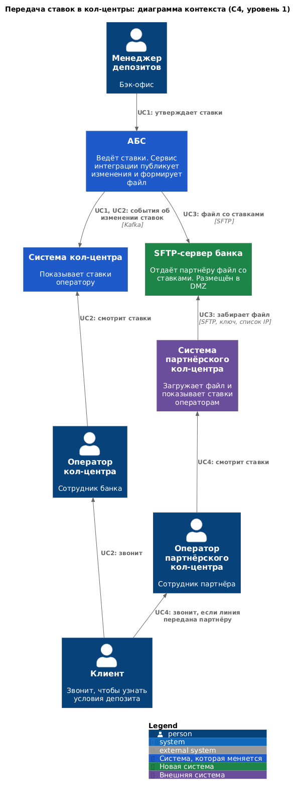
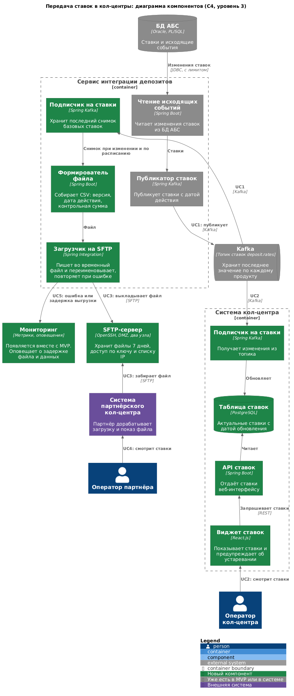
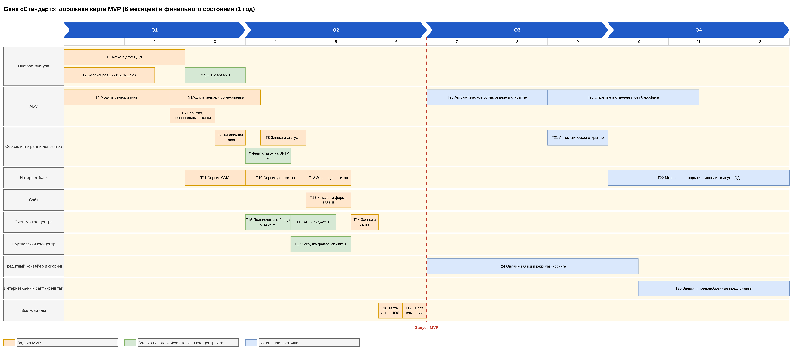

**Функциональные требования**

Решение опирается на [DEP-ADR1](../Task3/ADR.md): ставки уже ведутся в АБС и публикуются в Kafka.

За основу взят процесс из MVP: менеджеры утверждают ставки в АБС. Маркетинговая кампания стартует только после запуска MVP (T19), поэтому к её началу ставки уже ведутся в АБС. Если модуль ставок (T4) задержится, временный путь опирается на сегодняшний процесс. Менеджер депозитов выгружает ежедневный Excel-файл в согласованном формате, а сервис интеграции проверяет его, публикует ставки в тот же топик Kafka и выкладывает файл на SFTP. Оба кол-центра при этом работают без изменений. Путь ручной и нужен только до запуска модуля ставок.

|**№**|**Действующие лица или системы**|**Use Case**|**Описание**|
| :-: | :- | :- | :- |
|UC1|Менеджер депозитов, АБС, сервис интеграции депозитов, Kafka|Опубликовать ставки|1. Менеджер утверждает ставки в АБС. 2. Сервис интеграции читает изменение. 3. Сервис публикует ставки с датой действия в топик.|
|UC2|Клиент, оператор кол-центра, система кол-центра, Kafka|Проконсультировать клиента в кол-центре банка|1. Система кол-центра получает изменение ставок из Kafka и сохраняет у себя. 2. Клиент звонит. 3. Оператор открывает виджет и называет актуальную ставку.|
|UC3|Сервис интеграции депозитов, SFTP-сервер, система партнёрского кол-центра|Передать ставки партнёру файлом|1. Сервис формирует файл при изменении ставок и не реже раза в день. 2. Сервис выкладывает файл на SFTP-сервер банка. 3. Система партнёра по расписанию забирает файл и проверяет контрольную сумму.|
|UC4|Клиент, оператор партнёра, система партнёрского кол-центра|Проконсультировать клиента в партнёрском кол-центре|1. Клиент попадает к партнёру при перегрузке кол-центра банка. 2. Оператор видит ставки из последнего файла и дату их действия. 3. Если клиенту нужны особые условия, оператор предлагает оставить заявку на сайте или позвонить в банк. Точный порядок согласуется с партнёром.|
|UC5|Сервис интеграции, мониторинг, сотрудники IT|Заметить сбой передачи|1. Файл не выложен вовремя или данные устарели. 2. Мониторинг оповещает дежурного. 3. Дежурный выясняет причину и выкладывает файл повторно.|

**Нефункциональные требования**

Значения указаны как допущения для согласования с бизнесом и партнёром.

|**№**|**Требование**|
| :-: | :- |
|1|Новые ставки доступны оператору банка не позднее 5 минут после утверждения.|
|2|Новый файл появляется на SFTP не позднее 15 минут после утверждения, партнёр забирает его хотя бы каждый час.|
|3|Консультация кол-центра не зависит от доступности АБС и не добавляет нагрузки на её БД (P3, +R5, +R6 из [FURPS+](../Task2/FURPS+.md)).|
|4|Партнёр работает только с файлами: API-вызовы для него недоступны, а файл можно получать по SFTP.|
|5|Партнёр получает только базовые ставки. Персональные ставки и данные клиентов наружу не передаются (+R8, +R9).|
|6|Доступ партнёра к SFTP защищён ключом и списком IP, передача шифруется (+R7).|
|7|Файл не может быть прочитан частично: он появляется целиком, с версией и контрольной суммой.|
|8|Система кол-центра и передача файла работают 24/7 с доступностью 99,9% (R1). При сбое оператор видит устаревшие ставки с предупреждением, а не ошибку.|
|9|Используются технологии, которые уже есть в банке (Java Spring Boot, PostgreSQL) или появляются в MVP (Kafka) (+R1, +R2, +R3).|
|10|Операторы видят актуальные ставки к началу маркетинговой кампании: это условие её запуска.|

**Решение**

**Диаграмма контекста.** Файлы: [PNG](c4-context-rates-call-center.png), [исходник PlantUML](c4-context-rates-call-center.puml).

**Диаграмма компонентов.** Файлы: [PNG](c4-component-rates-call-center.png), [исходник PlantUML](c4-component-rates-call-center.puml).

**Логика выбора**

1. **Источник ставок остаётся один.** Менеджеры утверждают ставки в модуле АБС из MVP. Excel и письма больше не нужны для консультаций: иначе у кол-центров появились бы данные, расходящиеся с интернет-банком.
2. **Кол-центр банка подписан на топик Kafka (требования 1, 3, 9, +R14).** В системе кол-центра из MVP уже есть подписчик на заявки с сайта, она написана на Java и расширяема. Добавляются подписчик на ставки, таблица в PostgreSQL, API и виджет. Ставки читаются из своей таблицы, поэтому операторы не зависят от АБС.
3. **Файл для партнёра формирует сервис интеграции депозитов (требования 2, 4, 5).** Он уже работает со ставками, и команде АБС не нужен отдельный сервис. Файл собирается из топика Kafka, а не запросом к АБС, поэтому нагрузка на базу не растёт. В файл попадают только базовые ставки.
4. **SFTP-сервер банка размещён в DMZ (требования 4, 6).** Партнёр сам забирает файл, поэтому банк не хранит его учётные данные и не зависит от доступности его систем. Сервер развёрнут в двух узлах с общей папкой, а файлы хранятся 7 дней для разбора инцидентов.
5. **Файл выкладывается атомарно (требование 7).** Сервис пишет временный файл и переименовывает его, в содержимом есть версия, дата действия и контрольная сумма. Формат CSV выбран как самый простой для внешней системы и согласуется с партнёром.
6. **Сбои видны сразу (требование 8, UC5).** Мониторинг отслеживает возраст последнего файла и задержку подписчика. Виджет и файл показывают дату действия, чтобы оператор не называл устаревшую ставку как актуальную.

**Альтернативы**

1. **Кол-центр банка вызывает REST API сервиса интеграции.** Интеграция простая, но сервису пришлось бы хранить копию ставок или ходить в АБС при каждом запросе, а доступность кол-центра зависела бы от сервиса. Подходит как запасной вариант, если в платформу кол-центра будет сложно добавить подписчика.
2. **Доступ кол-центра к БД АБС.** Быстро в реализации, но это ещё одна прямая интеграция с перегруженной базой, а депозитные данные становятся доступны чужой системе. Отклонено.
3. **Банк сам отправляет файл на сервер партнёра.** Партнёр не поднимает клиент SFTP с расписанием, зато банк хранит его учётные данные и зависит от его сервера. Отклонено.
4. **Отправлять файл партнёру по почте.** Партнёр может начать сразу, но так продолжается текущая ручная практика: нет гарантии доставки, контроля версий и защиты. Допустимо только как временный ручной запасной путь при сбое SFTP.
5. **Отдельный сервис выгрузки файлов.** Его можно развивать и выпускать независимо, но для одного файла это лишний контейнер и сопровождение. Вернёмся к варианту, если появятся другие партнёрские выгрузки.

**Недостатки, ограничения, риски**

1. **Партнёр видит ставки с задержкой.** Между публикацией и загрузкой может пройти до часа, а в это время он называет прошлую ставку. Ставки обновляются раз в день, поэтому риск низкий, но в скрипт нужно добавить фразу о том, что точная ставка фиксируется при оформлении.
2. **Зависимость от партнёра.** Загрузку и показ файла дорабатывает внешняя компания, и сроки банк не контролирует. Это нужно закрепить в договоре, а запасным вариантом остаётся ручная передача файла.
3. **Сервис интеграции получает вторую обязанность.** Он связывает АБС с Kafka и готовит файл. Ошибка в одной части может затронуть другую, поэтому выгрузка выполняется в отдельном потоке и с отдельным мониторингом.
4. **Партнёр не может назвать персональные и специальные ставки.** Клиента придётся передавать в банк. Требование этого не запрещает: нужны хотя бы текущие ставки.
5. **Новая точка в DMZ.** SFTP-сервер нужно обновлять и защищать, а партнёр получает доступ к инфраструктуре банка. Поэтому у него только доступ на чтение к одной папке.
6. **Зависимость от MVP.** Без модуля ставок в АБС и Kafka передавать нечего, поэтому запуск кампании возможен только после завершения этих задач. Порядок показан в дорожной карте, а временный путь через Excel описан в начале ADR.
7. **Платформа кол-центра принадлежит подрядчику (+R14).** Изменения нужно согласовать с ним, чтобы не потерять поддержку и не получить конфликт при обновлении.

**Задачи по системам**

Задачи T1–T19 входят в MVP (6 месяцев), T20–T25 относятся к финальному состоянию (год). Новые задачи этого кейса отмечены знаком ★.

|Система|Код|Задача|Зависит от|
| :- | :- | :- | :- |
|Инфраструктура|T1|Развернуть Kafka в двух ЦОД, настроить топики и доступы|–|
|Инфраструктура|T2|Развернуть балансировщик и API-шлюз в двух ЦОД|–|
|Инфраструктура|T3 ★|Развернуть SFTP-сервер в DMZ, подключить партнёра|–|
|АБС|T4|Модуль ставок и роли: заменить Excel|–|
|АБС|T5|Модуль заявок и согласования ставки, экраны менеджера|T4|
|АБС|T6|Исходящие события и пакетный расчёт персональных ставок|T4|
|Сервис интеграции депозитов|T7|Публикация ставок в Kafka|T1, T6|
|Сервис интеграции депозитов|T8|Приём заявок с лимитом записи, публикация статусов|T5, T7|
|Сервис интеграции депозитов|T9 ★|Формирование файла ставок и загрузка на SFTP|T3, T7|
|Интернет-банк|T10|Сервис депозитов: копия ставок, каталог, заявки|T1, T7|
|Интернет-банк|T11|Сервис СМС: коды и уведомления|T1|
|Интернет-банк|T12|Экраны депозитов в веб-приложении|T10, T11|
|Сайт|T13|Каталог депозитов и форма заявки|T2, T10|
|Система кол-центра|T14|Приём заявок с сайта|T1, T13|
|Система кол-центра|T15 ★|Подписчик на ставки и таблица ставок|T1, T7|
|Система кол-центра|T16 ★|API и виджет ставок для оператора|T15|
|Партнёрский кол-центр|T17 ★|Загрузка файла, показ ставок операторам, новый скрипт|T9|
|Все команды|T18|Интеграционный и нагрузочный тест, проверка отказа ЦОД|T8, T12, T14, T16|
|Все команды|T19|Обучение сотрудников, пилот, запуск кампании MVP|T17, T18|
|АБС|T20|Правила автоматического согласования ставки и открытия депозита|T19|
|Сервис интеграции депозитов|T21|Автоматическое открытие депозита из заявки|T20|
|Интернет-банк|T22|Мгновенное открытие депозита и перевод монолита в два ЦОД|T21|
|АБС|T23|Открытие депозита в отделении без бэк-офиса|T20|
|Кредитный конвейер и скоринг|T24|Онлайн-заявки и режимы скоринга ([DEP-ADR3](../Task5/ADR.md))|T19|
|Интернет-банк и сайт|T25|Кредитные заявки и предодобренные предложения ([DEP-ADR3](../Task5/ADR.md))|T24|

**RoadMap**

Файлы: [draw.io](RoadMap_bank_Standart.drawio), [PNG](RoadMap_bank_Standart.png). Длительность задач примерная: сроки уточнятся после оценки командами.

Главные зависимости: инфраструктура и модуль ставок идут первыми, потому что без них нельзя начать остальные работы. Ставки в кол-центрах (T9, T15–T17) готовы до запуска кампании (T19), иначе звонки пожилых клиентов придут к операторам, у которых нет данных.
