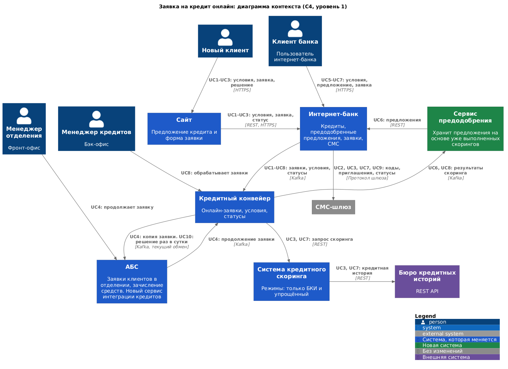
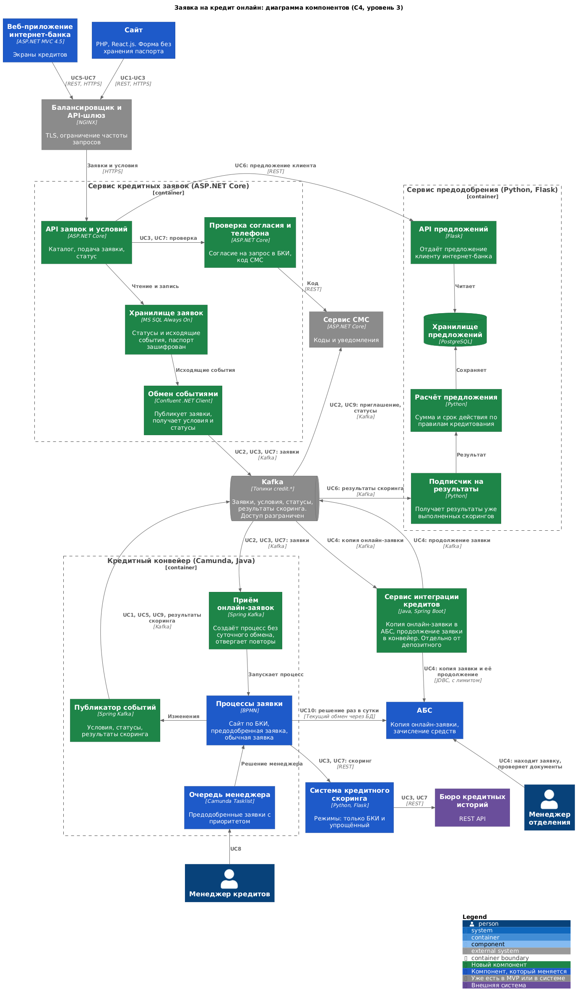

**Функциональные требования**

Коды требований взяты из [таблицы FURPS+](../Task2/FURPS+.md). Решение использует то, что появится в [MVP депозитов](../Task3/ADR.md): Kafka, API-шлюз и сервис СМС. Для связи с АБС добавляется отдельный сервис интеграции кредитов, устроенный так же, как сервис интеграции депозитов.

|**№**|**Действующие лица или системы**|**Use Case**|**Описание**|
| :-: | :- | :- | :- |
|UC1|Новый клиент, сайт, сервис кредитных заявок, конвейер|Посмотреть предложение на сайте|1. Конвейер публикует условия кредитов в Kafka. 2. Сервис кредитных заявок обновляет свою копию. 3. Сайт показывает предложение со ставкой. (F13)|
|UC2|Новый клиент, сайт, сервис заявок, конвейер, сервис СМС|Подать заявку без паспорта|1. Клиент указывает телефон и Ф. И. О. 2. Сервис сохраняет заявку и публикует событие. 3. Конвейер создаёт процесс. 4. Клиент получает СМС с приглашением в отделение. (F14, F16)|
|UC3|Новый клиент, сайт, сервис заявок, сервис СМС, конвейер, скоринг, БКИ|Получить решение по паспорту|1. Клиент вводит паспортные данные и даёт согласие на запрос в БКИ. 2. Клиент подтверждает телефон кодом. 3. Конвейер запускает скоринг в режиме «только БКИ». 4. Скоринг запрашивает БКИ. 5. Сайт показывает предварительное решение. 6. Клиент получает СМС с приглашением. (F15, F16, +R12)|
|UC4|Менеджер отделения, АБС, сервис интеграции кредитов, конвейер|Продолжить заявку в отделении|1. Копия онлайн-заявки уже находится в АБС. 2. Менеджер идентифицирует клиента и находит заявку. 3. Дополняет её и отправляет. 4. Сервис интеграции кредитов передаёт продолжение в конвейер по идентификатору той же заявки. Новую заявку менеджер создаёт как сейчас. (F17)|
|UC5|Клиент, интернет-банк, сервис заявок|Посмотреть кредиты в интернет-банке|1. Веб-приложение запрашивает условия. 2. Сервис отдаёт их из своей копии. (F18)|
|UC6|Клиент, интернет-банк, сервис заявок, сервис предодобрения|Увидеть предодобренное предложение|1. Сервис предодобрения заранее сохранил предложение по итогам прошлого скоринга. 2. Веб-приложение запрашивает его через сервис заявок. 3. Клиент видит сумму и срок действия. (F19, P9)|
|UC7|Клиент, интернет-банк, сервис заявок, сервис СМС, конвейер, скоринг|Подать заявку в интернет-банке|1. Клиент указывает счёт зачисления и данные заявки. 2. Подтверждает СМС-кодом. 3. Заявка попадает в конвейер сразу, через Kafka. 4. Если ситуация изменилась, конвейер запускает упрощённый скоринг. (F20, F21)|
|UC8|Менеджер кредитов, конвейер|Обработать заявку в тот же день|1. Предодобренная заявка попадает в очередь с приоритетом. 2. Менеджер изучает её и принимает решение. 3. Конвейер публикует статус и результат скоринга. (P6, P7)|
|UC9|Конвейер, Kafka, сервис заявок, сервис СМС, клиент|Сообщить о смене статуса|1. Конвейер публикует статус. 2. Сервис заявок обновляет его для экрана. 3. Сервис СМС отправляет клиенту сообщение. (F22, F23)|
|UC10|Конвейер, АБС|Зачислить средства|1. Одобренная заявка передаётся в АБС текущим обменом раз в сутки. 2. АБС зачисляет средства на счёт клиента. (текущий процесс)|

**Нефункциональные и архитектурно значимые требования**

|**№**|**Требование**|
| :-: | :- |
|R1, R2|Новые сервисы работают 24/7 с доступностью 99,9% и переживают сбой ЦОД.|
|R3, R4|Отказ АБС не мешает подать заявку. Заявки и статусы не теряются и не обрабатываются дважды.|
|R6|Недоступность БКИ не теряет заявку: клиент узнает решение позже.|
|P1|Отклик p95: не более 300 мс для чтения, не более 500 мс для записи заявки (допущение).|
|P3, +R5, +R6|БД АБС не получает дополнительной синхронной нагрузки, интернет-банк с ней напрямую не работает.|
|P6, P7|Предодобренная заявка обрабатывается в тот же рабочий день, решение приходит за один день, если данных достаточно.|
|P8|Решение на сайте приходит не дольше чем за 30 секунд (допущение).|
|P9|Скоринг не нагружается предрасчётами.|
|+R3|Обмен сообщениями строится на Kafka.|
|+R7, +R13|Трафик шифруется. Паспортные данные не хранятся на сайте и зашифрованы в защищённом контуре.|
|+R8|Депозитные и кредитные сотрудники и сервисы не получают данные друг друга.|
|+R10|Обмен между БД АБС и конвейера нельзя ускорить.|
|+R11|Конвейер и скоринг масштабируются горизонтально и работают 24/7.|
|+R12|Перед запросом в БКИ клиент даёт согласие и подтверждает телефон кодом.|
|+R15|Конвейер — коробка Camunda: часть доработок выполняет подрядчик, обработчики на Java и описания процессов меняют специалисты IT-отдела.|

**Решение**

**Диаграмма контекста.** Файлы: [PNG](c4-context-credit-online.png), [исходник PlantUML](c4-context-credit-online.puml).

**Диаграмма компонентов.** Файлы: [PNG](c4-component-credit-online.png), [исходник PlantUML](c4-component-credit-online.puml).

**Логика выбора**

1. **Онлайн-заявка сразу идёт в конвейер (P6, P7, +R10, +R11, +R15).** Суточный обмен через БД ускорить нельзя, поэтому онлайн-заявки его обходят: сервис кредитных заявок публикует событие, а новый компонент конвейера создаёт процесс. Camunda позволяет добавить обработчики на Java, а конвейер масштабируется и работает 24/7.
2. **Конвейер становится источником условий и статусов (F13, F18).** Он уже хранит полные условия кредитов. Сервис заявок получает их событиями и хранит копию, поэтому сайт и интернет-банк не ходят в конвейер при каждом просмотре.
3. **Отдельный сервис кредитных заявок (+R8, R3, S2).** Он повторяет подход сервиса депозитов, но разделён с ним: кредитные данные не смешиваются с депозитными, а топики credit.* закрыты для депозитных сервисов. Написан на ASP.NET Core для команды интернет-банка.
4. **Решение на сайте строится на режиме «только БКИ» (F15, +R12, R6).** В скоринг добавляется отдельный режим, потому что данных о новом клиенте в АБС нет. Запрос идёт только после согласия и подтверждения телефона, что защищает от злоупотреблений и лишних платных запросов. Сайт опрашивает статус заявки. Если бюро не отвечает, клиенту показывается сообщение, а решение приходит в СМС позже.
5. **Предодобрение использует готовые результаты (F19, P9).** Сервис предодобрения подписан на результаты скоринга, которые конвейер публикует после обычных заявок, и по правилам кредитования считает сумму и срок действия. Он не вызывает скоринг и поэтому не создаёт нагрузки предрасчётами. Написан на Python, потому что его развивают сотрудники IT-отдела, которые ведут скоринг, и использует уже знакомый им PostgreSQL.
6. **Упрощённый скоринг только при подаче заявки (F21, P9).** Это разовый запрос после действия клиента, а не массовый предрасчёт. Режим использует прошлый результат и проверяет только изменения, поэтому стоит дешевле полного скоринга.
7. **Приоритет заявки в конвейере (P6).** Предодобренные заявки попадают в отдельную очередь менеджеров, а мониторинг показывает те, что близки к концу рабочего дня.
8. **Одна заявка во всех системах (F17, R4, +R8).** Идентификатор заявки создаётся при подаче. Отдельный сервис интеграции кредитов на Java (команда АБС) записывает копию онлайн-заявки в АБС с ограниченной скоростью, чтобы менеджер работал с ней в привычном клиенте. Продолжение уходит в конвейер событием, а не суточным обменом. Сервис устроен как сервис интеграции депозитов, но не делит с ним данные, топики и учётные записи БД.
9. **СМС через существующий сервис (F20, F22).** Коды и статусы отправляет сервис СМС из MVP, поэтому ядро интернет-банка не меняется.
10. **Паспорт не остаётся на сайте (+R13).** Сайт передаёт данные через шлюз по TLS и не сохраняет их. В сервисе заявок поле зашифровано, а срок хранения определяет безопасность.

**Альтернативы**

1. **Подавать онлайн-заявки через АБС и суточный обмен.** Изменений меньше, но требование «в тот же день» не выполняется, а нагрузка на АБС растёт. Отклонено.
2. **Массово считать предодобрение в скоринге ночью.** Предложения появятся у большего числа клиентов. Но требование P9 просит не нагружать систему предрасчётами, а ночной расчёт всё равно занимает её ресурсы и ходит в платное бюро. Отклонено, можно вернуться после оценки нагрузки вне рабочих часов.
3. **Сайт напрямую вызывает скоринг.** Цепочка короче и ответ быстрее, но процесс и заявка окажутся вне конвейера, а публичный канал получит доступ к критичной системе. Отклонено.
4. **Обновлять условия файлами или опросом конвейера.** Реализация проще, однако условия устаревают, а опрос создаёт постоянную нагрузку. Отклонено, так как Kafka уже есть.
5. **Встроить предодобрение в конвейер.** Новый сервис не нужен, но онлайн-просмотры начнут нагружать конвейер, а сроки зависят от подрядчика. Отклонено.
6. **Добавить кредитный обработчик в сервис интеграции депозитов.** Сервисов меньше, и команда АБС сопровождает один контейнер. Но через него пойдут и депозитные, и кредитные данные, что противоречит +R8, а сбой одного потока затронет другой. Отклонено.

**Недостатки, ограничения, риски**

1. **Зачисление остаётся раз в сутки.** Решение приходит в тот же день, а деньги могут прийти на следующий. Требование касается обработки и решения, но клиенту об этом нужно сказать заранее.
2. **Предложения есть не у всех.** Они появляются только у клиентов, у которых уже был скоринг. Новые клиенты интернет-банка могут их не увидеть, а значит, охват кампании будет ограничен.
3. **Результат скоринга устаревает.** Предложение может не соответствовать текущей ситуации клиента. Поэтому у него есть срок действия, а при подаче работает упрощённый скоринг.
4. **Предварительное решение на сайте неточно.** Данные только из БКИ, поэтому в отделении итог может измениться. Формулировка на сайте и в СМС должна это отражать.
5. **Зависимость от бюро.** Время и стоимость запросов внешние, а значение 30 секунд нужно проверить на реальных ответах. Защита от злоупотреблений снижает лишние запросы, но полностью их не исключает.
6. **Доработка конвейера зависит от подрядчика (+R15).** Часть обработчиков банк может менять сам, но обновления коробочного решения нужно согласовать.
7. **Два пути заявок.** Новая заявка в отделении идёт через суточный обмен, а онлайн и продолжения через Kafka. Отчётность и сверка должны учитывать оба пути, и пока обмен не заменён, сложность сохраняется.
8. **Рост нагрузки на скоринг.** Заявки с сайта приходят и в рабочие часы, когда скоринг уже нагружен. Нужно проверить нагрузку и при необходимости масштабировать систему или ограничить частоту запросов.
9. **Нет данных о нагрузке.** Размеры компонентов и лимиты нельзя рассчитать, пока не известны ожидаемые объёмы заявок (P5).
10. **Юридические требования нужно подтвердить.** Формулировки согласия, хранение паспорта и сроки хранения должны проверить юристы и безопасность банка.
